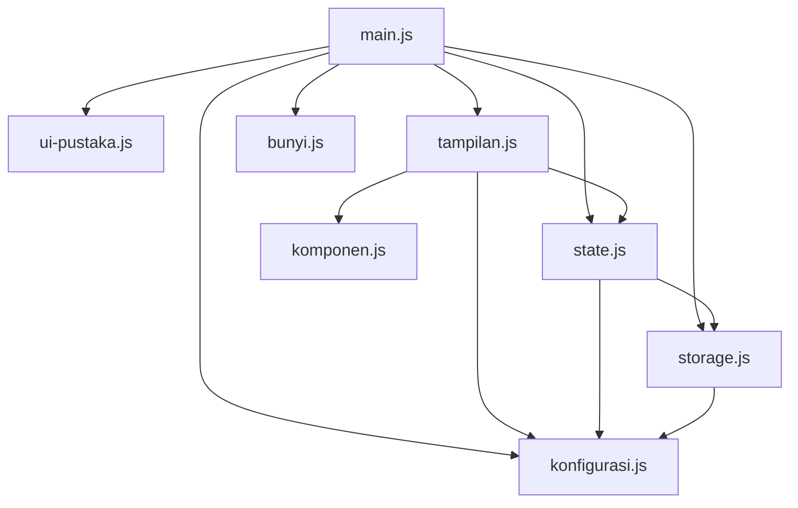

# MODULE_MAP

Peta modul aplikasi **Cari Jam Kosong Bareng**. Semua modul ada di folder `src/` dan dimuat dari `index.html` lewat satu baris:

```html
<script type="module" src="src/main.js"></script>
```

## Peta import (satu arah, tanpa melingkar)



Versi teks (format: modul → modul yang diimpornya):

```
main.js          ->  ui-pustaka.js, konfigurasi.js, state.js, storage.js, tampilan.js, bunyi.js
tampilan.js      ->  konfigurasi.js, state.js, komponen.js
state.js         ->  konfigurasi.js, storage.js
storage.js       ->  konfigurasi.js
komponen.js      ->  (tidak mengimpor apa pun)
ui-pustaka.js    ->  (tidak mengimpor apa pun)
konfigurasi.js   ->  (tidak mengimpor apa pun)
bunyi.js         ->  (tidak mengimpor apa pun)
```

## Tanggung jawab tiap modul

| Modul | Satu kalimat tanggung jawab |
|---|---|
| `main.js` | Titik masuk yang menghubungkan data, tampilan, pustaka UI, dan bunyi, lalu memasang semua event dengan `addEventListener`. |
| `state.js` | Satu-satunya pemilik data (anggota dan jam kosong), aturan validasi, dan perhitungan waktu cocok, tanpa menyentuh tampilan. |
| `storage.js` | Satu-satunya modul yang menyentuh `localStorage`: membaca dan menulis data dengan aman, menyaring data rusak, dan tidak pernah melempar galat. |
| `tampilan.js` | Menggambar dan memperbarui isi halaman (daftar anggota, tabel jadwal, hasil, tooltip, pindah tampilan) dengan hanya membaca data dari `state.js`. |
| `komponen.js` | Membuat potongan tampilan yang dipakai berulang (chip, item anggota, kartu hasil) sebagai elemen DOM, dengan semua teks pengguna lewat `textContent`. |
| `konfigurasi.js` | Menyimpan semua angka dan pengaturan tetap aplikasi (hari, jam, batas anggota, warna, kunci penyimpanan). |
| `bunyi.js` | Mengurus efek suara "ding" dan tombol bunyi nyala/mati. |
| `ui-pustaka.js` | Satu-satunya berkas yang memanggil API JavaScript Bootstrap (toast, modal konfirmasi, panel pintasan). |

## Bagian yang belum dimodulkan

- **Bootstrap tetap global.** `ui-pustaka.js` memakai objek `bootstrap` yang dimuat lewat tag `<script>` dari CDN, karena paket Bootstrap yang dipakai adalah bundel biasa (bukan ES module). Pembungkus ini sengaja dibuat agar hanya satu berkas yang bergantung pada global tersebut.
- **Alur drag dan pencarian masih di `main.js`.** Penanganan geser pointer dan alur `klikCari()` masih di satu berkas karena keduanya menghubungkan data, tampilan, dan bunyi sekaligus; memecahnya lagi akan membuat modul saling mengimpor.
- **`index.html` memuat Bootstrap CSS/JS dan font dari CDN.** Itu bagian dari struktur halaman, bukan kode aplikasi, jadi tidak dimodulkan.
